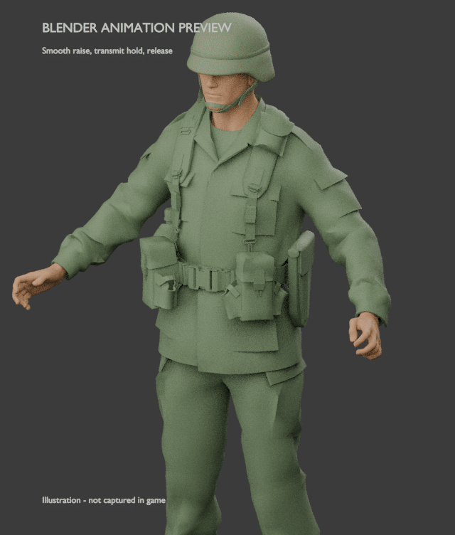

# Radio Collarbone animation preview

The left hand rises to the left collarbone, stays there while the player transmits on the radio, and returns when transmission stops. The revised grip places the palm flatter against the upper chest, with the fingers together and curled around the shoulder-microphone position and the thumb opposed. The thumb has been adjusted for clearance from the chest. This preview uses 0.4-second eased transitions, with individually rendered motion frames and a short hold.

**This is a Blender animation preview. Native Reforger import and in-game playback remain unverified.**

- [MP4 video](RadioCollarbone-preview.mp4)
- [Looping GIF](RadioCollarbone-preview.gif)
- [Hold pose image](RadioCollarbone-preview-hold.png)
- [Hand close-up](RadioCollarbone-preview-closeup.png)
- [Hand close-up from the side](RadioCollarbone-preview-closeup-left.png)
- [Thumb profile view](RadioCollarbone-preview-closeup-profile.png)

The preview is 3 seconds long at 640 × 752 pixels. The MP4 runs at 30 frames per second; the GIF uses the same poses with timing rounded to its supported 10-millisecond intervals. See the [police photo reference notes](REFERENCES.md) for the grip references.

## Attribution and license

Character and rig derived from Bohemia Interactive's [Arma Reforger Character Sample](https://github.com/BohemiaInteractive/Arma-Reforger-Samples/tree/83f12390d3dd61ed834d379f621520ed9f1b891d/SampleMod_NewCharacter/Assets/Characters/SampleCharacter). Copyright © Bohemia Interactive a.s. Licensed under the [Arma Public License](https://www.bohemia.net/community/licenses/arma-public-license), including attribution, noncommercial and Arma-only terms. Changes add the collarbone gesture and Blender preview. No endorsement is implied.

The original source license notice is preserved in [LICENSE-BOHEMIA-SAMPLES.txt](LICENSE-BOHEMIA-SAMPLES.txt).
